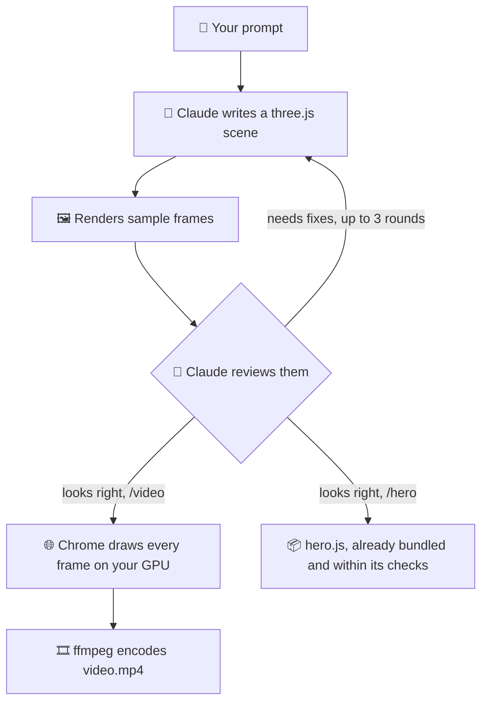

<div align="center">

# 🎬 Video Generator

### Type a prompt. Get an MP4 video or a live website animation.

Claude Code writes every scene as three.js code, checks its own frames, and your GPU does the rendering.<br>
**No image or video models. No extra API keys. No stock assets.**


</div>

## Choose what you want to make

<table>
  <tr>
    <th width="50%">🎞️ MP4 video</th>
    <th width="50%">🌊 Live website animation</th>
  </tr>
  <tr>
    <td align="center"></td>
    <td align="center"></td>
  </tr>
  <tr>
    <td>A video file to post, share or edit.</td>
    <td>Real three.js running on your site, behind your content.</td>
  </tr>
  <tr>
    <td>

```bash
npm run video -- "a lighthouse in the fog"
```

</td>
    <td>

```bash
npm run hero -- "a wave of violet dots"
```

</td>
  </tr>
  <tr>
    <td><strong>You get:</strong> <code>videos/&lt;slug&gt;/video.mp4</code></td>
    <td><strong>You get:</strong> <code>heroes/&lt;slug&gt;/dist/hero.js</code></td>
  </tr>
  <tr>
    <td><strong>Runs on:</strong> your machine, once. Viewers just watch the file.</td>
    <td><strong>Runs on:</strong> each visitor's GPU, for as long as the page is open.</td>
  </tr>
  <tr>
    <td><strong>Best for:</strong> social clips, shorts, and anything you'd upload.</td>
    <td><strong>Best for:</strong> animated headers that stay sharp, follow your theme and can react to the cursor.</td>
  </tr>
  <tr>
    <td align="center"><strong><a href="docs/mp4-videos.md">MP4 video guide →</a></strong></td>
    <td align="center"><strong><a href="docs/live-animations.md">Live animation guide →</a></strong></td>
  </tr>
</table>

See a live animation in production on [cotetiu-madalin-portfolio.vercel.app](https://cotetiu-madalin-portfolio.vercel.app/).

## Quick start

**You need:** Node 22, Chrome or Edge, and [Claude Code](https://claude.com/claude-code) signed in.

```bash
npm install
npm run video -- "a lighthouse in the fog, its beam sweeping across dark water"
```

## How the skills work

A **skill** is a set of written instructions that Claude Code follows when you call it. This project has two, one for each output. They share the same idea, with Claude reviewing its own work before finishing, and they differ in what happens at the end.



| | [`/video`](.claude/skills/video/SKILL.md) | [`/hero`](.claude/skills/hero/SKILL.md) |
|---|---|---|
| **Claude writes** | `videos/<slug>/scene.js`, with a beginning, a change and an ending | `heroes/<slug>/scene.js`, slow and ambient, playing forever |
| **Claude checks** | Is the subject recognizable? Is it well framed? Does it reach an ending? | Is the text readable? Does it work in dark, light and phone views, and after an hour? |
| **The tool enforces** | Nothing loads from outside your machine | The same, plus frame time, file size and transparency limits |
| **Script that runs** | `src/video/render.mjs` | `src/hero/build.mjs` |

**Two ways to run a skill:**

- **From your terminal,** with `npm run video` or `npm run hero`. It runs once and finishes, which suits a single generation.
- **Inside Claude Code,** by typing `/video <prompt>` or `/hero <prompt>`. You can then keep asking for changes in the same session.

## What it costs

**No additional cost.** You use only what you already have: Claude Code and your own machine. There's no extra AI service, image or video model, API key, or per-video charge. Generating simply draws on the usage your plan already includes.

Everything here was built and measured on a **basic Claude Code subscription**.

| Activity | What it uses | Additional cost |
|---|---|---|
| **Generate an MP4 video** | Your Claude usage: about 1.4M to 1.6M tokens, 7 to 8 minutes | **$0** |
| **Generate a live animation** | Your Claude usage: about 0.4M to 0.9M tokens, 2 to 3.5 minutes | **$0** |
| **Re-render or rebuild an existing scene** | Your machine only | **$0** |
| **Visitors viewing a live animation** | Their GPU, and your site's hosting | **$0** for AI |

One video used an estimated **10 to 13% of a session limit** and about 1% of the weekly limit, so roughly 7 to 10 similar videos fit in a session window. A simple live animation used about 5% of a session limit. Those are single measured runs, so yours will vary.

**[Full cost breakdown →](docs/costs.md)**

## Project layout

```text
.claude/skills/
  video/SKILL.md        Instructions Claude follows for /video
  hero/SKILL.md         Instructions Claude follows for /hero

src/
  run-skill.mjs         Runs a skill from the terminal (npm run video, npm run hero)
  video/                MP4 pipeline: frame capture and encoding
  hero/                 Live pipeline: bundling, budget checks, page runtime
  shared/               Local server, locked-down browser, scene helpers

videos/<slug>/scene.js  Generated videos (rendered MP4s stay out of git)
heroes/<slug>/scene.js  Generated animations (builds stay out of git)

docs/
  mp4-videos.md         Guide to MP4 videos
  live-animations.md    Guide to live animations
  costs.md              Full cost breakdown
  media/                Images and clips used in these docs
```

## Known issues

- **Tested on Windows only.** The tools look for browsers on macOS and Linux too, but that's untested.
- **Stopping a run isn't clean.** Killing the outer command may leave a generation running in the background, still using tokens.
- **A stopped run still exits 0.** If Claude halts part-way, `npm run video` and `npm run hero` still report success, so read the final message.

Each guide lists the limitations specific to that output.

## Ideas for later

- [ ] Procedural audio synced to the picture
- [ ] Clean cancellation and lower memory use
- [ ] Masking and placement options built into `/hero`
- [ ] A local web page for entering prompts
- [ ] Reusable style presets
