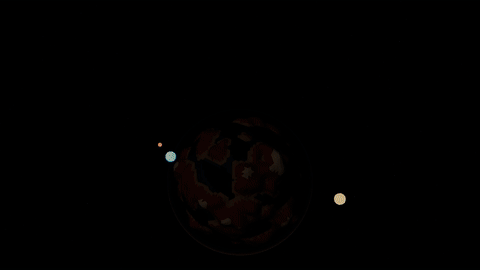
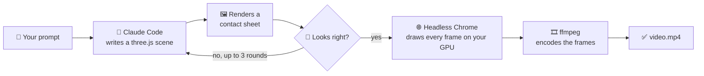

<div align="center">

# 🎬 Video Generator

### Type a prompt. Get a video. Every pixel is written as code.

**No image models. No video models. No API keys. No stock assets.**<br>
Claude Code writes a three.js scene from your prompt, and your own GPU renders it to MP4.


<br>


*"a hot air balloon drifting over misty mountains at sunrise, 8 seconds"*

</div>

## ✨ Gallery

<table>
  <tr>
    <td align="center" width="50%">
      <br>
      <sub><em>"a paper boat sailing through a stormy sea at night, with lightning flashes, vertical format for shorts, 6 seconds"</em></sub>
    </td>
    <td align="center" width="50%">
      <br>
      <sub><em>Hand-written reference scene that the generator learns the format from</em></sub>
    </td>
  </tr>
</table>

The prompted videos above came straight from the pipeline, with no manual edits. Their source is in [`videos/`](videos/). The GIFs are downscaled previews of the full-quality MP4s.

## 🚀 Quick start

**You need:** Node 22, Chrome or Edge, and [Claude Code](https://claude.com/claude-code) signed in.

```bash
npm install
npm run generate -- "a lighthouse in the fog, its beam sweeping across dark water"
```

Your video lands in `videos/<slug>/video.mp4`.

Prefer to work interactively? Open Claude Code in this folder and run `/video <prompt>`, then keep asking for changes.

## 🧠 How it works



The interesting step is the loop. Claude **looks at its own output**, critiques it and fixes the code before committing to a final render.

## 🔒 Built-in guarantees

| | |
|---|---|
| **Reproducible** | Scenes run on a virtual clock with seeded randomness. Two renders of the example scene were byte-identical. |
| **Local rendering** | Any scene that requests something outside the local server fails the render. |
| **Billed to your plan** | `generate` removes `ANTHROPIC_API_KEY` from its environment, so runs use your Claude Code login rather than per-token API billing. |
| **Scoped permissions** | The CLI lets Claude edit only `videos/` and run only the renderer. |

## 🛠️ Commands

| Command | What you get |
|---|---|
| `npm run generate -- "prompt"` | The full pipeline, from prompt to MP4 |
| `node src/render.mjs videos/<slug>/scene.js` | Full render to `video.mp4` |
| `node src/render.mjs videos/<slug>/scene.js --preview` | 12-frame contact sheet at `preview.png` |
| `node src/render.mjs videos/<slug>/scene.js --at 2.5` | One full-resolution frame |

## 📊 What a video costs

There are no per-video charges, but generation does use your Claude Code plan. Measured on a Windows laptop with an RTX 4050 and Opus 5.5:

| Video | Length | Tokens | Time |
|---|---|---|---|
| Paper boat | 6s, vertical | 1.56M | ~8 min |
| Hot air balloon | 8s, 1080p | 1.42M | ~7 min |

- About 90% of those tokens are low-cost cache reads.
- The balloon run used **10–13% of a session limit** and about **1% of a weekly limit**. That's an estimate from one run, and it will vary by plan and prompt.
- Almost all the time goes to writing and refining the scene. The final render takes seconds.

## 📁 Project layout

```text
.claude/skills/video/SKILL.md   The prompt-to-video workflow and scene contract
src/generate.mjs                CLI that runs the skill through `claude -p`
src/render.mjs                  Local server + headless Chrome + ffmpeg
src/runtime/                    Browser side: frame loop, virtual clock, helpers
videos/<slug>/scene.js          Generated scenes (rendered files stay out of git)
```

## 🚧 Current limitations

- **Stylized, not photorealistic.** Everything is procedural 3D, so real people and live-action footage become an interpretation.
- **Silent.** There's no audio yet.
- **Checked by stills.** Claude reviews sampled frames, not playback, so motion is worth checking yourself.
- **Memory hungry.** ffmpeg reached about 1 GB during a 1080p render, which can be tight on a 16 GB machine with other work running.
- **Cancelling isn't clean yet.** Killing the outer command may leave a generation running in the background.
- **Tested on Windows only.** The renderer looks for browsers on macOS and Linux too, but that's untested.

## 🗺️ Ideas for later

- [ ] Procedural audio synced to the picture
- [ ] Clean cancellation and lower memory use
- [ ] A local web page for entering prompts
- [ ] Reusable style presets
