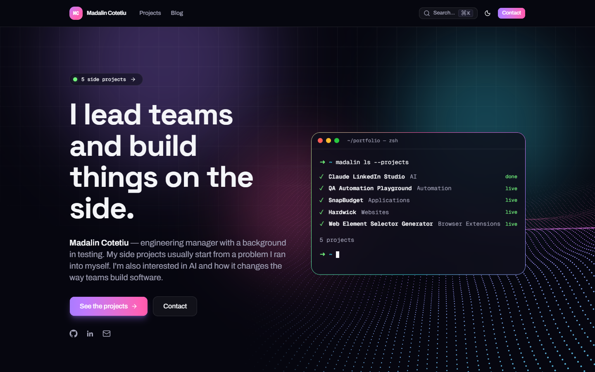

# Live website animations

Use this when you want **motion running on your own website**, such as an animated header. Nothing is recorded: the page runs real three.js code on each visitor's GPU, so it stays sharp at any size, follows your light and dark themes, and can react to the cursor. For a video file, see [MP4 videos](mp4-videos.md).

<p align="center">
  <br>
  <sub><em>The <code>dot-ocean</code> scene on its own. <a href="media/dot-wave.mp4">Watch the smoother MP4</a></em></sub>
</p>
<p align="center">
  <br>
  <sub><em>In production on <a href="https://cotetiu-madalin-portfolio.vercel.app/">cotetiu-madalin-portfolio.vercel.app</a></em></sub>
</p>

## Make an animation

Include your brand colors in the prompt, as hex values, if you have them:

```bash
npm run hero -- "a flowing wave of small dots, in violet #ab7cff and cyan #3adaf2"
```

Or open Claude Code in this folder and type:

```text
/hero a flowing wave of small dots, in violet #ab7cff and cyan #3adaf2
```

The result is one file, `heroes/<slug>/dist/hero.js`, with three.js already inside it. Your site needs no new dependencies, no API keys and no AI at runtime.

## What the `/hero` skill does

A skill is a set of written instructions that Claude Code follows when you call it. This one lives in [`.claude/skills/hero/SKILL.md`](../.claude/skills/hero/SKILL.md). Claude writes the scene, and `src/hero/build.mjs` bundles and checks it.

1. **Plans.** Chooses a palette for both dark and light themes. It assumes text covers the left half on desktop and most of the width on phones, and it keeps motion slow, with no flashing.
2. **Writes the scene.** Creates `heroes/<slug>/scene.js`. The scene has to stay transparent and depend only on time and pointer position, so it can run for as long as a page stays open.
3. **Builds and measures.** Bundles the scene, then runs it on your integrated GPU under a strict Content Security Policy. If any check below fails, the command exits with an error.
4. **Checks its own work.** Looks at `preview.png`, with rows for dark, light and phone width, and a final column showing the scene after an hour. Is the sample headline readable? Is the animation visible in light mode? It fixes what's wrong, for up to 3 rounds.
5. **Reports.** Gives you the file path, frame time, size, and anything it couldn't achieve.

### The checks every build must pass

| Check | Limit | `dot-ocean` |
|---|---|---|
| Median frame at 1920x1080, on the integrated GPU | 12 ms | 1.3 ms |
| 95th percentile frame | 20 ms | 3.4 ms |
| Download size, gzipped, including three.js | 250 KB | 134 KB |
| Fully opaque pixels, so the page still shows through | 50% | 0% |
| Visible motion | Required | Yes |
| Similar coverage after an hour on screen | Required | Yes |

## Add it to your site

Build it and copy the file into your site's public folder. Rebuilding like this **doesn't use Claude or any tokens**, and the file is only copied if every check passes:

```bash
npm run hero:build -- heroes/<slug>/scene.js --out ../my-site/public/hero
```

Then mount it on an element that has a position set and fills the area you want to animate:

```html
<div id="hero" style="position: absolute; inset: 0; z-index: -1; pointer-events: none"></div>

<script type="module">
  const { mount } = await import('/hero/hero.js');
  const hero = mount(document.getElementById('hero'), { theme: 'dark' });
  // Later: hero.setTheme('light') or hero.destroy()
</script>
```

The container needs its own stacking context, for example `isolation: isolate`, so that `z-index: -1` keeps the animation behind your content but in front of the page background.

**Using Next.js or another bundler?** Load the file at runtime so the bundler leaves it alone, and call `destroy()` on unmount:

```js
const url = '/hero/hero.js';
const { mount } = await import(/* turbopackIgnore: true */ /* webpackIgnore: true */ url);
```

### What it handles for you

- **Resizing:** follows its container.
- **Pausing:** stops drawing when off-screen or when the tab is hidden.
- **Reduced motion:** shows a still frame instead of animating.
- **Slow devices:** lowers its resolution, and falls back to a still frame if that isn't enough.
- **No WebGL:** does nothing, so whatever is behind it stays visible.

### What you may need to handle

**Keeping text readable.** A scene can't know where each page puts its text. If your pages have different layouts, mask the animation with CSS. The portfolio shows the wave only past each page's text column, fades it out before the header ends, and dims it on narrow screens:

```css
mask-image:
  linear-gradient(to bottom, black 55%, transparent 100%),
  linear-gradient(to right, transparent calc(50% + 7.5rem), black calc(50% + 19.5rem));
mask-composite: intersect;
```

**Data saver.** The runtime doesn't check for it. If you want to skip the download for those visitors, test `navigator.connection?.saveData` before importing the file.

## Speed and cost

The two measured runs took 2 to 3.5 minutes. Generating draws on your Claude Code usage once, at no additional cost, and after that your site runs the file with **no AI involved at all**. See [What it costs](costs.md).

## Limitations

- **Not measured on real phones.** The checks run on a laptop's integrated GPU, so phone performance is unknown.
- **Uses the visitor's GPU and battery.** It's light, and it pauses off-screen, but it still does more work than a static image.
- **Keep motion ambient.** The skill is aimed at quiet backgrounds, not attention-grabbing effects.
